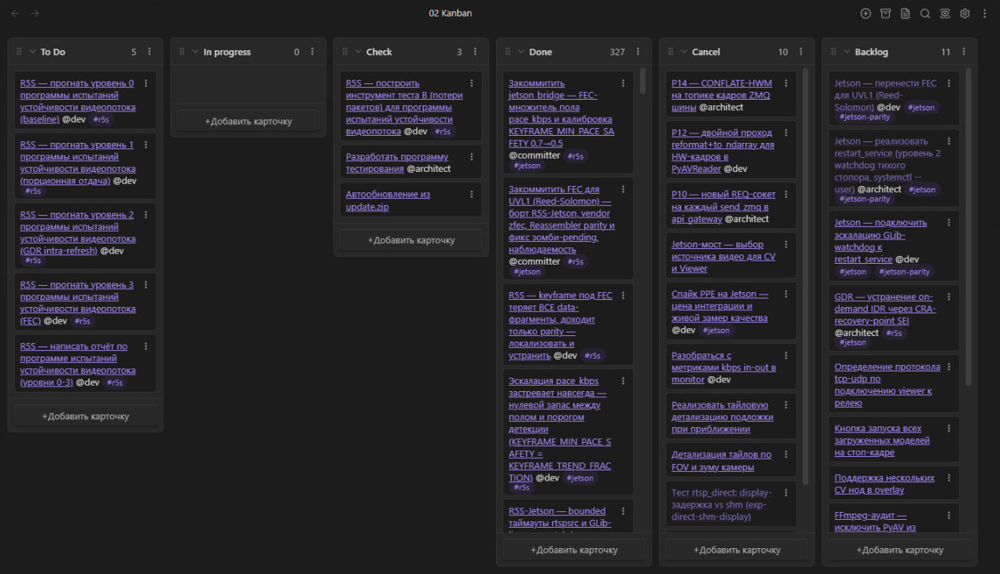
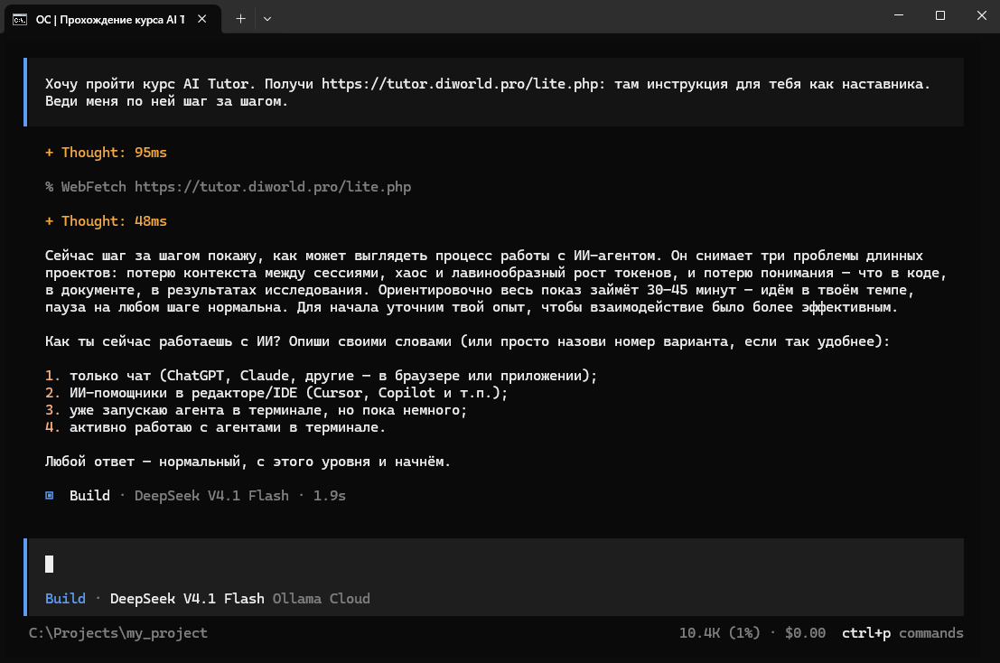

# AI Tutor

Процесс работы с ИИ-агентом в терминале: память проекта, правила для агента и доска задач. Агент не теряет контекст между разговорами и работает по задачам, а не по переписке.



*Доска задач рабочего проекта. Агент берёт задачи из To Do, отмечает ход работы и сдаёт результат на проверку. В Done 327 задач. В шаблоне доска проще, колонки To Do, In progress, Check и Done.*

## Что в репозитории

В папке `lite-template/` — инструкции для работы по этому процессу.

## ИИ-наставник

Если с освоением процесса возникнут трудности, поможет ИИ-наставник. Он развернёт процесс на учебном проекте и по ходу объяснит каждый шаг, это займёт 30–45 минут. Откройте ИИ-агента в терминале (OpenCode, Claude Code или другой) в пустой папке и вставьте первым сообщением:

```
Хочу пройти курс AI Tutor. Получи https://tutor.diworld.pro/lite.php: там инструкция для тебя как наставника. Веди меня по ней шаг за шагом.
```



*Начало обучения в OpenCode. Наставник получил инструкцию, рассказал, как пройдёт работа, и спрашивает об опыте с ИИ.*

Подробнее: https://tutor.diworld.pro

Как перенести процесс на свой проект: https://tutor.diworld.pro/guide.html

## Лицензия

[CC BY-NC-SA 4.0](LICENSE). Шаблон можно использовать и менять в своих проектах, включая рабочие. Продавать курс, шаблон или материалы на их основе нельзя.

Плагин Obsidian Kanban в `lite-template/.obsidian/plugins/obsidian-kanban/` распространяется под [GPL-3.0](lite-template/.obsidian/plugins/obsidian-kanban/LICENSE), автор — [mgmeyers](https://github.com/community-archive/obsidian-kanban).
